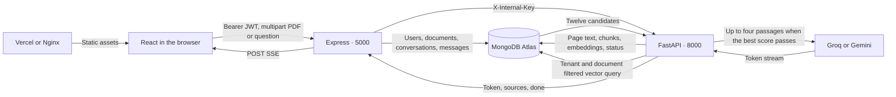

# DocChat

Upload a PDF, ask a question and open the cited passage to check the answer. DocChat streams Markdown into the conversation and links each returned source to its filename, physical page, excerpt and relevance score. A question outside the retrieved evidence can produce an abstention.

## Demo

| Portfolio media | Capture to add |
|---|---|
| Demo GIF | Upload a public sample, ask a question and open a citation. |
| Desktop screenshot | Show a complete answer with its source panel open. |
| Mobile screenshot | Show document selection or chat at 375 px. |

<!-- Replace the placeholders with the actual assets when available.


-->

## Architecture



## Tech stack

| Layer | Implementation | Responsibility |
|---|---|---|
| Browser | React, Vite, Tailwind, Axios, React Router, react-markdown | Authenticated workspace, uploads, streaming and source inspection |
| API | Node.js, Express, Mongoose, bcrypt, JWT, Multer, Zod | Identity, ownership, quotas, persistence and stream relay |
| Retrieval | Python 3.11, FastAPI, PyMuPDF, sentence-transformers | Page-local text extraction, embedding and re-ranking |
| Data | MongoDB Atlas and Atlas Vector Search | Application records and filtered 384-dimensional cosine search |
| Generation | Groq or Gemini behind `generate_stream()` | Grounded answers with page citations |
| Delivery | Docker Compose, Nginx, Vercel, Render, GitHub Actions | Local stack, hosting and automated tests |

## Features

- PDF magic-byte validation, a 50 MiB file limit, a 500-page limit, and per-user quotas of 10 documents and 200 MiB. The library shows upload progress and processing status.
- Page-local windows of 400 tokenizer tokens with 60 tokens of overlap. The service embeds batches of 32 with `all-MiniLM-L6-v2` and re-ranks with `cross-encoder/ms-marco-MiniLM-L-6-v2`.
- Every Atlas search prefilters by user and selected ready documents. The answer prompt includes the most recent four messages and treats retrieved passages as untrusted document text.
- Live Markdown, clickable citations, copy, stop generation, saved conversations, a keyboard-accessible mobile drawer and dark mode. Disconnecting a client cancels the upstream request.

## Local setup

Use Docker with Compose v2.22+ (or a newer compatible release), an Atlas cluster with its vector index, and a Groq or Gemini API key. Run these PowerShell commands from the repository root.

```powershell
foreach ($service in 'server', 'ai-service', 'client') {
    $target = Join-Path $service '.env'
    if (!(Test-Path -LiteralPath $target)) {
        Copy-Item -LiteralPath (Join-Path $service '.env.example') -Destination $target
    }
}
```

Set the values in the following table, allow your IP in Atlas, and create the vector index on `docchat.chunks`. Use two independent random secrets for the JWT signing key and the shared internal key. The first AI image build downloads both models. [Atlas setup and deployment](DEPLOYMENT.md) · [Index JSON](ai-service/atlas-vector-index.json)

```powershell
docker compose up --build --watch
```

Open [the workspace](http://localhost:5173), register, upload a text PDF, wait for **Ready**, select its checkbox, and ask a question. Express and FastAPI expose local health endpoints on ports 5000 and 8000. Compose rebuilds affected services as watched source files change. Use `docker compose down` to stop the stack.

For native development, use the per-service install instructions. Set Express `PORT=5000` and client `VITE_API_URL=http://localhost:5000/api` to match this guide. The existing native templates default to port 4000. Compose supplies the 5000 configuration and the browser-facing API URL itself. [Client setup](client/README.md) · [Express setup](server/README.md) · [FastAPI setup](ai-service/README.md)

### Environment variables

| Set in | Names | Local configuration |
|---|---|---|
| Browser build | `VITE_API_URL` | Public Express URL ending in `/api`. Compose supplies `http://localhost:5000/api`. |
| Both backends | `MONGODB_URI`, `MONGODB_DB`, `INTERNAL_KEY` | Same Atlas data and matching service key. Default database is `docchat`. |
| Express | `JWT_SECRET`, `PORT`, `CLIENT_URL`, `AI_URL` | Secret of at least 32 characters. Compose sets 5000, `http://localhost:5173` and `http://ai-service:8000`. |
| Express | `AI_TIMEOUT_MS`, `TRUST_PROXY_HOPS` | Defaults 120000 and 0. |
| FastAPI | `VECTOR_INDEX`, `RERANK_THRESHOLD`, `LLM_TIMEOUT_SECONDS` | Defaults `chunk_embeddings`, 0.50 and 60. |
| FastAPI | `LLM_PROVIDER`, `GROQ_API_KEY`, `GROQ_MODEL`, `GEMINI_API_KEY`, `GEMINI_MODEL` | Choose one provider and set its key and model. The container reads `PORT` for Uvicorn (default 8000). |

## API overview

Express JSON routes use a Bearer JWT after registration or login. Uploads use multipart field `file`. Each authenticated resource is scoped to its owner.

| Express route | Action |
|---|---|
| `GET /health` | Public health check |
| `POST /api/auth/register`, `POST /api/auth/login`, `GET /api/auth/me` | Create an account, sign in, read the current user |
| `POST /api/documents`, `GET /api/documents` | Accept a PDF with HTTP 202, list documents |
| `GET /api/documents/:id`, `DELETE /api/documents/:id` | Read status, delete an owned document and its chunks |
| `GET /api/conversations`, `POST /api/conversations` | List or create chats with a document selection |
| `PATCH /api/conversations/:id`, `DELETE /api/conversations/:id` | Update or remove a conversation |
| `GET /api/conversations/:id/messages`, `POST /api/conversations/:id/messages` | Read history or submit a question and receive SSE |

FastAPI exposes `GET /health`, `POST /ingest`, `POST /ask` and `DELETE /documents/{doc_id}?user_id={user_id}`. All internal operations require `X-Internal-Key`. A successful chat streams `token` text, a JSON `sources` list, then `done`. Express commits the completed answer with its sources.

## Evaluation results

Replace the bracketed cells with results from your labeled PDFs. Record corpus revision **[hash or tag]**, held-out question count **[N]**, document scope **[files or corpus ID]**, and run date **[date]**. The evaluator calls the production retriever directly. [Evaluation commands, label format and 40-question protocol](ai-service/eval/README.md)

| Questions | k | Hits | Hit-rate@k | MRR@k | MRR@4 |
|---:|---:|---:|---:|---:|---:|
| [N] | 4 | [hits] | [hit rate] | [MRR] | [MRR] |

Paste the ablation runner’s Markdown rows here. These example rows identify the matched pair used by the résumé bullets.

| Tokens | Overlap | Chunks | Re-ranker | k | Questions | Hits | Hit-rate@k | MRR@k | MRR@12 |
|---:|---:|---:|:---|---:|---:|---:|---:|---:|---:|
| 400 | 60 | [chunks] | off | 4 | [N] | [hits] | [rate off] | [MRR off] | [MRR at 12] |
| 400 | 60 | [chunks] | on | 4 | [N] | [hits] | [rate on] | [MRR on] | [MRR at 12] |

Optional answer correctness (0–1) **[mean]**, graded **[count]/[N]**, provider/model **[identifier]**, threshold **[value]**. Report the held-out result for the configuration selected on development questions.

## Known limitations

- Scanned image-only and password-protected PDFs require preprocessing. Physical page numbers can differ from printed page labels. Complex layouts and charts can lose context during text extraction.
- Uploads use temporary disk. The original PDF is discarded after ingestion. A restart can interrupt a background job and leave a document in processing. Keep the originals for replay and evaluation.
- Atlas indexing is eventually consistent. Retrieval can miss a relevant passage, and generated claims or citations may still be wrong. Source chips expose the text for review.
- The encoder accepts at most 512 positions. An 800-token ablation window can contain text beyond its embedding prefix. Provider quotas, hosting memory and cold starts affect responsiveness.

## Future work

- Add OCR with per-page extraction diagnostics and a labeled scanned-document benchmark.
- Move ingestion to durable jobs with retry state, optional original-file retention and recovery after restarts.
- Compare hybrid lexical/vector retrieval on rare names and numerical questions. Measure citation support separately from answer correctness.

## Résumé bullets to complete after measurement

- Built a full-stack PDF chat application that retrieved the correct source page in **[hits] of [N] held-out questions** at k=4 and streamed answers with inspectable page citations.
- Benchmarked cross-encoder re-ranking against vector-only retrieval on identical Atlas candidates. At 400 tokens and 60 overlap, MRR@4 moved from **[MRR off] to [MRR on]**.
- Evaluated **[number of measured configurations]** combinations of chunk size, overlap, cutoff and re-ranking. Selected **[configuration]** on a development set and measured **[held-out hit-rate@k]** with **[chunks]** indexed chunks.

## CI

GitHub Actions runs ESLint and the Express integration tests, plus Ruff and pytest for FastAPI and the evaluation tools. Express tests create a temporary MongoDB replica set. CI uses local fixtures for the model providers and the retrieval boundary. Running the labeled Atlas benchmark is a separate measurement. [Workflow](.github/workflows/ci.yml)
